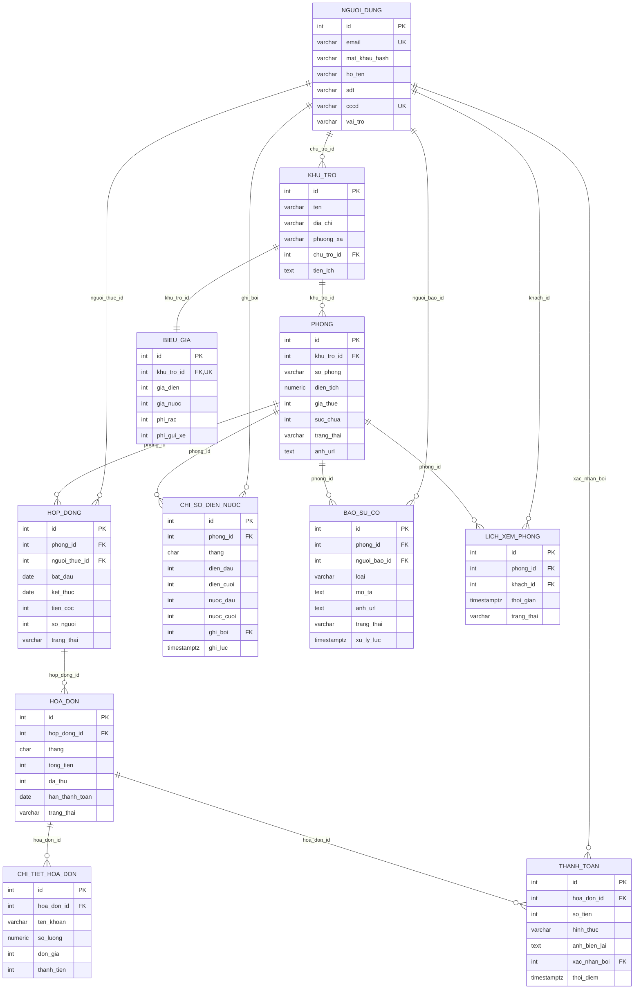

# Báo cáo phần Backend - CSDL - Triển khai

**Đồ án:** Hệ thống quản lý nhà trọ - phòng cho thuê  
**Môn:** INT4211 - Lập trình trên các thiết bị di động  
**Đề:** 12  
**Nhóm:** 555  
**Thành viên A:** Nguyễn Việt Quang - 231A290134  
**Phạm vi:** mục 3 (Thiết kế CSDL), mục 4 (Thiết kế API), mục 6 (Triển khai),
mục 7 (9 ca kiểm thử backend), mục 8 (phần việc của A), mục 9 (tự đánh giá).

---

## 3. Thiết kế cơ sở dữ liệu

### 3.1. Tổng quan

CSDL gồm **11 bảng** quan hệ, chạy trên PostgreSQL (Supabase). Toàn bộ định nghĩa
nằm trong `backend/schema.sql`; dữ liệu mẫu nằm trong `backend/seed.sql`. Hai tệp
đều chạy lại được nhiều lần: `schema.sql` dùng `DROP TABLE IF EXISTS ... CASCADE`,
`seed.sql` xóa dữ liệu cũ trước khi sinh lại.

Các nhóm bảng:

| Nhóm | Bảng |
|---|---|
| Tài khoản | `nguoi_dung` |
| Cơ sở vật chất | `khu_tro`, `phong`, `bieu_gia` |
| Hợp đồng & tiêu thụ | `hop_dong`, `chi_so_dien_nuoc` |
| Hóa đơn & thanh toán | `hoa_don`, `chi_tiet_hoa_don`, `thanh_toan` |
| Dịch vụ | `bao_su_co`, `lich_xem_phong` |

### 3.2. Sơ đồ quan hệ thực thể (ERD)



### 3.3. Mô tả chi tiết các bảng

| Bảng | Cột chính | Khóa ngoại | Ràng buộc quan trọng |
|---|---|---|---|
| `nguoi_dung` | `id`, `email`, `mat_khau_hash`, `ho_ten`, `sdt`, `cccd`, `vai_tro` | - | `email` UNIQUE, `cccd` UNIQUE, `vai_tro IN (CHU_TRO, QUAN_LY, NGUOI_THUE)` |
| `khu_tro` | `id`, `ten`, `dia_chi`, `phuong_xa`, `chu_tro_id`, `tien_ich` | `chu_tro_id → nguoi_dung.id` | `ON DELETE RESTRICT` |
| `phong` | `id`, `khu_tro_id`, `so_phong`, `dien_tich`, `gia_thue`, `suc_chua`, `trang_thai`, `anh_url` | `khu_tro_id → khu_tro.id` | `UNIQUE(khu_tro_id, so_phong)`, `trang_thai IN (TRONG, DA_THUE, DANG_SUA)`, `dien_tich > 0`, `gia_thue >= 0`, `suc_chua >= 1` |
| `bieu_gia` | `id`, `khu_tro_id`, `gia_dien`, `gia_nuoc`, `phi_rac`, `phi_gui_xe` | `khu_tro_id → khu_tro.id` | `khu_tro_id` UNIQUE (1-1), các đơn giá `>= 0`, `ON DELETE CASCADE` |
| `hop_dong` | `id`, `phong_id`, `nguoi_thue_id`, `bat_dau`, `ket_thuc`, `tien_coc`, `so_nguoi`, `trang_thai` | `phong_id → phong.id`, `nguoi_thue_id → nguoi_dung.id` | `ket_thuc > bat_dau`, `tien_coc >= 0`, `so_nguoi >= 1`, `trang_thai IN (HIEU_LUC, HET_HAN, DA_HUY)` |
| `chi_so_dien_nuoc` | `id`, `phong_id`, `thang`, `dien_dau`, `dien_cuoi`, `nuoc_dau`, `nuoc_cuoi`, `ghi_boi`, `ghi_luc` | `phong_id → phong.id`, `ghi_boi → nguoi_dung.id` | `UNIQUE(phong_id, thang)`, `dien_cuoi >= dien_dau`, `nuoc_cuoi >= nuoc_dau`, `thang ~ '^[0-9]{4}-(0[1-9]|1[0-2])$'` |
| `hoa_don` | `id`, `hop_dong_id`, `thang`, `tong_tien`, `da_thu`, `han_thanh_toan`, `trang_thai` | `hop_dong_id → hop_dong.id` | `UNIQUE(hop_dong_id, thang)`, `tong_tien >= 0`, `0 <= da_thu <= tong_tien`, `trang_thai IN (CHUA_THU, MOT_PHAN, DA_THU, QUA_HAN)` |
| `chi_tiet_hoa_don` | `id`, `hoa_don_id`, `ten_khoan`, `so_luong`, `don_gia`, `thanh_tien` | `hoa_don_id → hoa_don.id` | các cột tiền `>= 0`, `ON DELETE CASCADE` |
| `thanh_toan` | `id`, `hoa_don_id`, `so_tien`, `hinh_thuc`, `anh_bien_lai`, `xac_nhan_boi`, `thoi_diem` | `hoa_don_id → hoa_don.id`, `xac_nhan_boi → nguoi_dung.id` | `so_tien > 0`, `hinh_thuc IN (TIEN_MAT, CHUYEN_KHOAN)`, `xac_nhan_boi` NULL = chờ xác nhận |
| `bao_su_co` | `id`, `phong_id`, `nguoi_bao_id`, `loai`, `mo_ta`, `anh_url`, `trang_thai`, `xu_ly_luc` | `phong_id → phong.id`, `nguoi_bao_id → nguoi_dung.id` | `trang_thai IN (MOI, DANG_XU_LY, DA_XU_LY)` |
| `lich_xem_phong` | `id`, `phong_id`, `khach_id`, `thoi_gian`, `trang_thai` | `phong_id → phong.id`, `khach_id → nguoi_dung.id` | `trang_thai IN (CHO_XAC_NHAN, DA_XAC_NHAN, TU_CHOI)`, `ON DELETE CASCADE` |

### 3.4. Chỉ mục (index)

| Index | Mục đích |
|---|---|
| `idx_khu_tro_chu_tro` | Lọc khu theo chủ trọ |
| `idx_phong_khu_tro`, `idx_phong_trang_thai` | Danh sách phòng theo khu / trạng thái |
| `idx_hop_dong_phong`, `idx_hop_dong_nguoi_thue`, `idx_hop_dong_trang_thai` | Tra hợp đồng hiện hành, hợp đồng của tôi |
| `idx_chi_so_thang` | Báo cáo tiêu thụ theo tháng |
| `idx_hoa_don_thang`, `idx_hoa_don_trang_thai`, `idx_hoa_don_han` | Lọc hóa đơn, công nợ, quá hạn |
| `idx_chi_tiet_hoa_don` | Lấy chi tiết hóa đơn |
| `idx_thanh_toan_hoa_don` | Lịch sử thanh toán |
| `idx_bao_su_co_phong`, `idx_bao_su_co_trang_thai` | Danh sách sự cố |
| `idx_lich_xem_phong_phong`, `idx_lich_xem_phong_trang_thai` | Lịch xem theo phòng / trạng thái |

### 3.5. Quyết định thiết kế và lý do

1. **Tiền lưu `INTEGER` (đồng), không dùng `FLOAT`.** Tránh sai số khi cộng tiền
   điện, nước, rác, gửi xe. Các phép chia (ví dụ `MOT_PHAN`) được xử lý ở backend.
2. **`thang` lưu `CHAR(7)` dạng `YYYY-MM`.** So sánh chuỗi trực tiếp cho đúng thứ
   tự thời gian, dễ hiển thị, có CHECK định dạng.
3. **`UNIQUE(phong_id, thang)` cho chỉ số** và **`UNIQUE(hop_dong_id, thang)` cho
   hóa đơn** là chốt chặn cuối cùng ở CSDL, kể cả khi hai request đến đồng thời.
   Backend vẫn kiểm tra trước để trả `409` thân thiện.
4. **`CHECK(dien_cuoi >= dien_dau)`** bảo vệ công tơ chạy lùi ở tầng CSDL, không
   chỉ dựa vào validate của app.
5. **`0 <= da_thu <= tong_tien`** chặn cộng tiền vượt hóa đơn.
6. **`ON DELETE RESTRICT`** ở các bảng nghiệp vụ (khu, phòng, hợp đồng, hóa đơn)
   để không xóa nhầm dữ liệu đang được tham chiếu. Chỉ `chi_tiet_hoa_don`,
   `bieu_gia`, `lich_xem_phong` dùng `CASCADE` vì là dữ liệu phụ thuộc.
7. **Một bảng `nguoi_dung` cho cả 3 vai trò.** Tránh trùng lặp cột đăng nhập;
   `vai_tro` quyết định quyền. Đăng ký mới mặc định `NGUOI_THUE`.
8. **`bieu_gia` tách riêng khỏi `khu_tro`.** Mỗi khu có một bảng giá; giá được
   chốt tại thời điểm phát hành hóa đơn, hóa đơn cũ không bị đổi khi sửa giá.

### 3.6. Dữ liệu mẫu

`seed.sql` sinh dữ liệu theo `CURRENT_DATE` nên tháng demo luôn là tháng hiện tại.

| Bảng | Số lượng | Ghi chú |
|---|---:|---|
| `nguoi_dung` | 47 | 1 chủ trọ, 1 quản lý, 45 người thuê; mật khẩu `123456` |
| `khu_tro` | 3 | Bình Thạnh, Thủ Đức, Gò Vấp |
| `phong` | 60 | 20 phòng/khu; 15 đã thuê, 3 trống, 2 đang sửa mỗi khu |
| `bieu_gia` | 3 | Mỗi khu một biểu giá |
| `hop_dong` | 45 | Mỗi phòng đã thuê một hợp đồng hiệu lực |
| `chi_so_dien_nuoc` | 315 | 45 phòng × 7 tháng (1 tháng gốc + 6 tháng tính tiền) |
| `hoa_don` | 270 | 45 hợp đồng × 6 tháng |
| `chi_tiet_hoa_don` | 1350 | 5 khoản/hóa đơn |
| `thanh_toan` | 234 | Nhiều trạng thái, có giao dịch chờ xác nhận |
| `bao_su_co` | 10 | Đủ 3 trạng thái |
| `lich_xem_phong` | 9 | Đủ 3 trạng thái |

Các tình huống được cài sẵn để demo:

- 9 phòng trống cho app Client tìm và đặt lịch.
- 5 phòng có tháng gần nhất tiêu thụ điện gấp 3 lần bình thường.
- Nhiều hóa đơn quá hạn hơn 10 ngày, có `QUA_HAN`.
- Hóa đơn tháng gần nhất có đủ `CHUA_THU`, `MOT_PHAN`, `DA_THU`.

---

## 4. Thiết kế API

### 4.1. Nguyên tắc

- REST, đúng động từ: `GET` đọc, `POST` tạo, `PATCH` sửa một phần, `DELETE` xóa.
- Tên trường `snake_case`, thống nhất với CSDL.
- Mọi quyết định nghiệp vụ nằm ở backend: tính tiền, kiểm tra trạng thái, phân quyền.
- Xác thực bằng JWT; mật khẩu băm bcrypt; không trả `mat_khau_hash`.
- SQL luôn dùng tham số `$1, $2`; không nối chuỗi.
- Lỗi trả JSON `{ "loi": "..." }`, có `chi_tiet` khi cần chỉ rõ trường sai.

### 4.2. Luồng xác thực

```text
POST /auth/dang-nhap
        │
        ▼
  bcrypt.compare(matKhau, mat_khau_hash)
        │ đúng
        ▼
  jwt.sign({ id, vaiTro, hoTen, email }, JWT_SECRET, 7d)
        │
        ▼
  App lưu token, gửi header Authorization: Bearer <token>
        │
        ▼
  xacThuc (sai/thiếu → 401) → choPhep(...vaiTro) (sai vai trò → 403)
```

### 4.3. Danh sách endpoint

Ký hiệu quyền: **P** = public, **T** = `NGUOI_THUE`, **Q** = `CHU_TRO` + `QUAN_LY`,
**C** = chỉ `CHU_TRO`, **A** = mọi vai trò đã đăng nhập.

| # | Method | Đường dẫn | Quyền | File |
|---|---|---|---|---|
| 1 | GET | `/health` | P | `index.js` |
| 2 | GET | `/` | P | `index.js` |
| 3 | POST | `/auth/dang-ky` | P | `auth.js` |
| 4 | POST | `/auth/dang-nhap` | P | `auth.js` |
| 5 | GET | `/auth/toi` | A | `auth.js` |
| 6 | GET | `/phong` | P | `khach.js` |
| 7 | GET | `/phong/:id` | P | `khach.js` |
| 8 | POST | `/lich-xem-phong` | T | `khach.js` |
| 9 | GET | `/lich-xem-phong/cua-toi` | T | `khach.js` |
| 10 | DELETE | `/lich-xem-phong/:id` | T | `khach.js` |
| 11 | GET | `/hop-dong/cua-toi` | T | `khach.js` |
| 12 | GET | `/hoa-don/cua-toi` | T | `khach.js` |
| 13 | GET | `/thanh-toan/cua-toi` | T | `khach.js` |
| 14 | POST | `/thanh-toan` | T | `khach.js` |
| 15 | POST | `/bao-su-co` | T | `khach.js` |
| 16 | GET | `/bao-su-co/cua-toi` | T | `khach.js` |
| 17 | GET | `/nhac-han` | T | `khach.js` |
| 18 | POST | `/upload/anh` | A | `khach.js` |
| 19 | GET | `/khu-tro` | Q | `chu_tro.js` |
| 20 | GET | `/khu-tro/:id` | Q | `chu_tro.js` |
| 21 | POST | `/khu-tro` | C | `chu_tro.js` |
| 22 | PATCH | `/khu-tro/:id` | C | `chu_tro.js` |
| 23 | DELETE | `/khu-tro/:id` | C | `chu_tro.js` |
| 24 | POST | `/phong` | C | `chu_tro.js` |
| 25 | PATCH | `/phong/:id` | C | `chu_tro.js` |
| 26 | DELETE | `/phong/:id` | C | `chu_tro.js` |
| 27 | GET | `/hop-dong` | Q | `chu_tro.js` |
| 28 | GET | `/hop-dong/:id` | Q | `chu_tro.js` |
| 29 | POST | `/hop-dong` | C | `chu_tro.js` |
| 30 | PATCH | `/hop-dong/:id` | C | `chu_tro.js` |
| 31 | GET | `/bieu-gia` | Q | `chu_tro.js` |
| 32 | GET | `/bieu-gia/:khuTroId` | Q | `chu_tro.js` |
| 33 | PATCH | `/bieu-gia/:khuTroId` | C | `chu_tro.js` |
| 34 | GET | `/chi-so-dien-nuoc` | Q | `chu_tro.js` |
| 35 | POST | `/chi-so-dien-nuoc` | Q | `chu_tro.js` |
| 36 | GET | `/hoa-don` | Q | `chu_tro.js` |
| 37 | POST | `/hoa-don/phat-hanh` | Q | `chu_tro.js` |
| 38 | GET | `/hoa-don/:id` | A | `chu_tro.js` / `khach.js` |
| 39 | GET | `/thanh-toan` | Q | `chu_tro.js` |
| 40 | PATCH | `/thanh-toan/:id/xac-nhan` | C | `chu_tro.js` |
| 41 | GET | `/lich-xem-phong` | Q | `chu_tro.js` |
| 42 | PATCH | `/lich-xem-phong/:id` | Q | `chu_tro.js` |
| 43 | GET | `/nguoi-dung` | Q | `chu_tro.js` |
| 44 | GET | `/bao-su-co` | Q | `chu_tro.js` |
| 45 | PATCH | `/bao-su-co/:id` | Q | `chu_tro.js` |
| 46 | GET | `/bao-cao/tong-quan` | Q | `chu_tro.js` |
| 47 | GET | `/bao-cao/cong-no` | Q | `chu_tro.js` |
| 48 | GET | `/bao-cao/lap-day` | Q | `chu_tro.js` |
| 49 | GET | `/bao-cao/doanh-thu` | C | `chu_tro.js` |
| 50 | GET | `/bao-cao/tieu-thu-bat-thuong` | Q | `chu_tro.js` |

Chi tiết body, query, response mẫu và mã lỗi của từng endpoint nằm trong
`backend/api.md`. Postman collection có 46 request, tự lưu token sau khi đăng nhập.

### 4.4. Ma trận phân quyền

| Chức năng | CHU_TRO | QUAN_LY | NGUOI_THUE |
|---|:---:|:---:|:---:|
| Xem khu / phòng / hợp đồng | ✓ | ✓ | Chỉ dữ liệu của mình |
| Tạo / sửa / xóa khu, phòng | ✓ | ✗ (403) | ✗ (403) |
| Tạo / hủy hợp đồng | ✓ | ✗ (403) | ✗ (403) |
| Xem biểu giá | ✓ | ✓ | ✗ (403) |
| Sửa biểu giá | ✓ | ✗ (403) | ✗ (403) |
| Ghi chỉ số điện nước | ✓ | ✓ | ✗ (403) |
| Phát hành hóa đơn | ✓ | ✓ | ✗ (403) |
| Xác nhận thanh toán | ✓ | ✗ (403) | ✗ (403) |
| Xem doanh thu | ✓ | ✗ (403) | ✗ (403) |
| Xem công nợ / lấp đầy / bất thường | ✓ | ✓ | ✗ (403) |
| Xác nhận lịch xem | ✓ | ✓ | ✗ (403) |
| Xử lý sự cố | ✓ | ✓ | ✗ (403) |
| Gửi thanh toán / báo sự cố | ✗ | ✗ | ✓ |

### 4.5. Mã trạng thái và cách dùng

| Mã | Tình huống điển hình |
|---|---|
| 200 | Lấy danh sách, cập nhật, xác nhận thành công |
| 201 | Tạo tài khoản, khu, phòng, hợp đồng, chỉ số, hóa đơn, thanh toán, sự cố, lịch |
| 400 | Thiếu trường, sai định dạng, chỉ số cuối < đầu, vượt sức chứa, thiếu ảnh |
| 401 | Không token, token sai/hết hạn, sai mật khẩu |
| 403 | Đã đăng nhập nhưng sai vai trò hoặc không sở hữu dữ liệu |
| 404 | Không tìm thấy tài nguyên hoặc route |
| 409 | Trùng tháng, trùng số phòng, phòng đã thuê, giao dịch đã xác nhận |
| 500 | Lỗi không lường trước |
| 502 | Supabase Storage lỗi |

### 4.6. Ví dụ hai endpoint điểm nhấn

**Ghi chỉ số:**

```http
POST /chi-so-dien-nuoc
Authorization: Bearer <token>
Content-Type: application/json

{ "phong_id": 1, "thang": "2026-11", "dien_cuoi": 5000, "nuoc_cuoi": 200 }
```

```json
{
  "chi_so": {
    "phong_id": 1,
    "thang": "2026-11",
    "dien_dau": 4670,
    "dien_cuoi": 5000,
    "nuoc_dau": 191,
    "nuoc_cuoi": 200,
    "tieu_thu_dien": 330,
    "tieu_thu_nuoc": 9
  },
  "canh_bao": {
    "loai": "DIEN_TANG_VOT",
    "tieu_thu_hien_tai": 330,
    "trung_binh_3_thang": 150,
    "phan_tram_tang": 120
  }
}
```

**Phát hành hóa đơn hàng loạt:**

```http
POST /hoa-don/phat-hanh?thang=2026-11&khuTro=2
Authorization: Bearer <token>
```

```json
{
  "thang": "2026-11",
  "khu_tro_id": 2,
  "so_hoa_don_da_tao": 15,
  "tong_tien": 61200000,
  "da_tao": [{ "hoa_don_id": 271, "phong_id": 21, "so_phong": "101", "tong_tien": 4080000 }],
  "bo_qua": [{ "phong_id": 22, "so_phong": "102", "ly_do": "Đã có hóa đơn tháng này" }],
  "thieu_chi_so": [{ "phong_id": 23, "so_phong": "103" }],
  "canh_bao_bat_thuong": [{ "phong_id": 24, "so_phong": "104", "tieu_thu_dien": 330 }]
}
```

### 4.7. Màn hình app gọi endpoint nào

| App | Màn hình | Endpoint |
|---|---|---|
| Admin | Đăng nhập | `POST /auth/dang-nhap` |
| Admin | Khu trọ | `GET/POST/PATCH/DELETE /khu-tro` |
| Admin | Phòng | `GET /phong?khuTro=`, `POST/PATCH/DELETE /phong` |
| Admin | Hợp đồng | `GET/POST/PATCH /hop-dong`, `GET /nguoi-dung?vaiTro=NGUOI_THUE` |
| Admin | Ghi chỉ số | `GET/POST /chi-so-dien-nuoc` |
| Admin | Hóa đơn | `GET /hoa-don`, `POST /hoa-don/phat-hanh`, `GET /hoa-don/:id` |
| Admin | Thanh toán | `GET /thanh-toan`, `PATCH /thanh-toan/:id/xac-nhan` |
| Admin | Lịch xem | `GET/PATCH /lich-xem-phong` |
| Admin | Sự cố | `GET/PATCH /bao-su-co` |
| Admin | Báo cáo | `GET /bao-cao/*` |
| Client | Tìm phòng | `GET /phong`, `GET /phong/:id` |
| Client | Đặt lịch | `POST /lich-xem-phong`, `GET/DELETE /lich-xem-phong/cua-toi` |
| Client | Hợp đồng | `GET /hop-dong/cua-toi` |
| Client | Hóa đơn | `GET /hoa-don/cua-toi`, `GET /hoa-don/:id` |
| Client | Thanh toán | `GET/POST /thanh-toan`, `GET /thanh-toan/cua-toi` |
| Client | Sự cố | `POST/GET /bao-su-co` |
| Client | Nhắc hạn | `GET /nhac-han` |

---

## 6. Triển khai

### 6.1. Kiến trúc triển khai

```text
App Android (Retrofit) ─┐
                        ├── HTTPS ──> Render Web Service (Node.js/Express)
App Flutter (http) ─────┘                    │
                                             ├── pg Pool (SSL) ──> Supabase PostgreSQL
                                             └── HTTPS ──> Supabase Storage (ảnh)
```

- Backend và hai app dùng chung một CSDL Supabase.
- Ảnh biên lai / sự cố lưu trên Supabase Storage, CSDL chỉ lưu URL.
- Render Free cấp domain HTTPS, tự cấp `PORT`.

### 6.2. Chuẩn bị Supabase

1. Tạo project Free, ghi lại `PROJECT_REF`, mật khẩu CSDL.
2. **SQL Editor** → dán `backend/schema.sql` → Run.
3. Dán tiếp `backend/seed.sql` → Run.
4. Kiểm tra nhanh:

```sql
SELECT count(*) FROM phong;      -- 60
SELECT count(*) FROM hop_dong;   -- 45
SELECT count(*) FROM hoa_don;    -- 270
```

5. **Storage** → tạo bucket `anh`, bật Public (hoặc dùng signed URL).
6. **Connect** → **Connection pooling** → **Session mode**, cổng `5432` → copy
   chuỗi kết nối. Không dùng Direct connection vì là IPv6.

### 6.3. Biến môi trường trên Render

| Biến | Giá trị |
|---|---|
| `DATABASE_URL` | Chuỗi Session pooler cổng 5432 |
| `JWT_SECRET` | Chuỗi ngẫu nhiên ≥ 32 ký tự, không commit |
| `JWT_HAN` | `7d` |
| `PGSSL` | `true` |
| `SUPABASE_URL` | `https://<PROJECT_REF>.supabase.co` |
| `SUPABASE_SERVICE_KEY` | Service role key (chỉ đặt trên server) |
| `SUPABASE_BUCKET` | `anh` |
| `NODE_ENV` | `production` |

### 6.4. Tạo Render Web Service

**Cách 1 - Blueprint (khuyến nghị):**

1. Render → **New → Blueprint**.
2. Chọn repo GitHub.
3. Render đọc `backend/render.yaml`, tạo service `rental-nhom555-api`.
4. Điền các biến `sync: false`, bấm **Apply**.

**Cách 2 - Thủ công:**

| Trường | Giá trị |
|---|---|
| Root Directory | `backend` |
| Runtime | Node |
| Build Command | `npm install` |
| Start Command | `node src/index.js` |
| Health Check Path | `/health` |
| Plan | Free |

### 6.5. Kiểm tra sau triển khai

```bash
curl https://rental-nhom555-api.onrender.com/health
```

Kỳ vọng:

```json
{ "ok": true, "ten": "555Rental API - Nhóm 555", "phien_ban": "1.0.0", "db": "ok" }
```

Kiểm tra thêm:

```bash
curl -i https://rental-nhom555-api.onrender.com/khu-tro
# 401 vì thiếu token

curl -X POST https://rental-nhom555-api.onrender.com/auth/dang-nhap \
  -H "Content-Type: application/json" \
  -d '{"email":"chutro@555rental.vn","matKhau":"123456"}'
# 200 + token
```

### 6.6. Lỗi thường gặp và cách xử lý

| Lỗi | Nguyên nhân | Cách sửa |
|---|---|---|
| `ENETUNREACH` / `ETIMEDOUT` | Dùng Direct connection IPv6 | Đổi sang Session pooler cổng 5432 |
| `self signed certificate` | Chưa bật SSL đúng | Đặt `PGSSL=true`; code dùng `rejectUnauthorized: false` |
| `password authentication failed` | Sai mật khẩu / sai user pooler | Copy lại nguyên chuỗi kết nối |
| `relation "..." does not exist` | Chưa chạy `schema.sql` | Chạy schema rồi seed trên đúng project |
| `/health` 200 nhưng `db` lỗi | Sai `DATABASE_URL` hoặc Supabase pause | Kiểm tra chuỗi, khôi phục project |
| Render 502 | Service chưa khởi động xong / crash | Xem Logs, kiểm tra `JWT_SECRET`, `DATABASE_URL` |
| Ảnh lỗi 500 `Chưa cấu hình SUPABASE...` | Thiếu biến Storage | Thêm `SUPABASE_URL`, `SUPABASE_SERVICE_KEY` |
| Render ngủ | Gói Free ngủ sau 15 phút | Gọi `/health` trước demo 3 phút |
| Supabase pause | Free pause sau 7 ngày không hoạt động | Vào dashboard khôi phục trước bảo vệ |

### 6.7. Bảo mật triển khai

- `.env` nằm trong `.gitignore`, repo chỉ có `.env.example`.
- `SUPABASE_SERVICE_KEY` chỉ đặt trên Render, không nhúng vào app.
- JWT secret riêng cho production, không dùng chuỗi mẫu.
- CORS bật; có thể giới hạn origin nếu chỉ phục vụ app.
- `helmet` không bắt buộc nhưng có thể thêm; hiện tại đã tắt `x-powered-by`.
- Mọi truy vấn dùng tham số, đã kiểm thử SQL injection.

### 6.8. Trạng thái triển khai

- **CSDL Supabase:** đã tạo project, chạy `schema.sql` + `seed.sql` thành công
  trên PostgreSQL 17 (Session pooler, region `ap-southeast-1`). Kiểm tra lại:
  60 phòng, 45 hợp đồng, 315 chỉ số, 270 hóa đơn, 1350 chi tiết, 234 thanh toán,
  3 khu trọ, 47 người dùng, 44 hóa đơn quá hạn.
- **Backend trên CSDL thật:** đã chạy smoke test 18/18 ca đạt ngay trên Supabase
  (health, đăng nhập 3 vai trò, 401/403, tìm phòng, hợp đồng, hóa đơn, báo cáo,
  chặn chỉ số lùi, SQL injection) — dữ liệu mẫu không bị thay đổi.
- **Render:** đã đặt biến môi trường cho service `rental-nhom555-api` bằng
  Render API rồi deploy lại. Bản mới nhất (`dep-dbqjhg3rjlhs73fveeug`, commit
  `68ffe36`) trạng thái `live`; đã bật `healthCheckPath=/health`.
- **Kiểm tra production sau deploy:**
  - `GET /health` → `200` `{"ok":true,"ten":"555Rental API - Nhóm 555",
    "phien_ban":"1.0.0",...,"db":"ok"}`.
  - `GET /phong` → `200` (danh sách phòng trống từ CSDL thật).
  - Đăng nhập `chutro@555rental.vn` → `200` + JWT; sai mật khẩu → `401`.
  - `GET /hoa-don?thang=2026-10` có token → `200`; thiếu token → `401`
    (`{"loi":"Thiếu token đăng nhập"}`).
  - `GET /bao-cao/doanh-thu` có token → `200`, số liệu khớp seed
    (3 khu trọ, phải thu/đã thu/còn nợ).
  - `GET /phong?dienTichTu=abc` → `400`; `GET /phong?limit=-5` → `200` và
    kẹp còn 1 phòng (không còn lỗi `500`).
  - `GET /hoa-don?trangThai=QUA_HAN` → `200`, 44 hóa đơn quá hạn.
  - `GET /nguoi-dung?vaiTro=NGUOI_THUE` bằng token chủ trọ → `200`, 45 người
    thuê (chủ trọ sở hữu cả 3 khu nên vẫn thấy đủ, không lộ dữ liệu khu khác).
  - `POST /hoa-don/phat-hanh?thang=2026-11` thiếu `khuTro` → `400` với thông
    báo "Thiếu tham số khuTro...".
- **Biến đã đặt trên Render** (giá trị thật chỉ nằm trong Environment, không
  commit): `NODE_ENV=production`, `PGSSL=true`, `JWT_HAN=7d`,
  `DATABASE_URL` (Session pooler cổng `5432`), `JWT_SECRET` (64 ký tự),
  `SUPABASE_BUCKET=anh`, `SUPABASE_URL`, `SUPABASE_SERVICE_KEY`.
- **Upload ảnh production:** `POST /upload/anh` (multipart field `anh`) trả
  `201` kèm URL public trên Supabase Storage (bucket `anh`), đã kiểm tra thực tế.
- Trước khi nộp: chạy checklist mục 9.4 và ghi ảnh chụp `/health` từ máy khác.

---

## 7. Kiểm thử backend

### 7.1. Cách chạy

Bộ kiểm thử end-to-end nằm trong repo tại `backend/test/`, dùng PGlite
(PostgreSQL nhúng) + socket server, chạy `schema.sql`, `seed.sql`, khởi động
Express trên cổng test rồi gọi API thật bằng `fetch`.

```bash
cd backend
npm install
npm test           # test:sql + test:api
```

GitHub Actions chạy lại toàn bộ bộ test mỗi lần push vào `main`
(`.github/workflows/backend-test.yml`). Kết quả lần chạy cuối: **88/88 ca đạt**.

### 7.2. Chín ca kiểm thử backend

| # | Ca kiểm thử | Dữ liệu vào | Kết quả mong đợi | Kết quả thực tế | Đạt |
|---|---|---|---|---|---|
| 1 | Đăng nhập sai mật khẩu và gọi API không token | `chutro@555rental.vn` + `sai_mat_khau`; `GET /auth/toi` không header | `401` cho cả hai, không lộ email tồn tại | `401` + `{"loi":"Email hoặc mật khẩu không đúng"}`; `401` + `{"loi":"Thiếu token đăng nhập"}` | ✅ |
| 2 | Phân quyền sai vai trò | Token `NGUOI_THUE` gọi `GET /nguoi-dung`; token `QUAN_LY` gọi `PATCH /bieu-gia/1` và `GET /bao-cao/doanh-thu` | Tất cả `403`, kể cả khi app không ẩn nút | `403` + `{"loi":"Không có quyền thực hiện chức năng này"}` ở cả 3 request | ✅ |
| 3 | Không tìm thấy tài nguyên | `GET /khong-ton-tai`; `GET /hoa-don/999999` | `404` | `404` + `{"loi":"Không tìm thấy đường dẫn GET /khong-ton-tai"}`; hóa đơn `404` | ✅ |
| 4 | Chỉ số cuối nhỏ hơn chỉ số đầu | `phong_id=2`, `dien_cuoi=10`, chỉ số đầu thực tế lớn hơn | `400`, `chi_tiet.truong = "dien_cuoi"` | `400` + `chi_tiet {truong: "dien_cuoi", dien_dau: 1659, dien_cuoi: 10}` | ✅ |
| 5 | Ghi trùng chỉ số một tháng | Ghi lại `phong_id=1`, `thang=2026-11` lần 2 | `409`, không tạo bản ghi mới | `409` + `{"loi":"Phòng 101 đã ghi chỉ số tháng 2026-11"}` | ✅ |
| 6 | Phát hành hóa đơn hàng loạt | `POST /hoa-don/phat-hanh?thang=2026-11&khuTro=2` sau khi ghi đủ 15 chỉ số | `201`, tạo 15 hóa đơn, mỗi hóa đơn 5 khoản, tổng chi tiết = `tong_tien`, có cảnh báo bất thường | `201`, `so_hoa_don_da_tao=15`; 15 hóa đơn × 5 chi tiết; tổng khớp; `canh_bao_bat_thuong` có phần tử | ✅ |
| 7 | Phát hành lần 2 không nhân đôi | Gọi lại đúng tháng + khu | `201`, `so_hoa_don_da_tao=0`, `bo_qua` 15 | `201`, tạo 0, bỏ qua 15 với lý do “Đã có hóa đơn tháng này” | ✅ |
| 8 | Rollback khi lỗi giữa transaction | Tạo trigger tạm báo lỗi khi `UPDATE hoa_don`, gọi `PATCH /thanh-toan/:id/xac-nhan` | `500`; `thanh_toan.xac_nhan_boi` vẫn NULL | `500`; giao dịch vẫn NULL; sau khi bỏ trigger xác nhận lại `200` và cộng đúng tiền | ✅ |
| 9 | SQL injection ở tìm phòng | `GET /phong?khuVuc='; DROP TABLE phong; --` | `200`, bảng `phong` còn nguyên | `200`; `SELECT count(*) FROM information_schema.tables WHERE table_name='phong'` = 1 | ✅ |

### 7.3. Các nhóm kiểm thử khác đã chạy

- Đăng ký mới `201`, trùng email `409`, email quá 120 ký tự `400`.
- Token ký HS512 (khác thuật toán của hệ thống) bị từ chối `401`.
- Tham số tìm phòng sai (`dienTichTu=abc`) trả `400`; `limit` âm được kẹp về 1
  thay vì gây lỗi `500`.
- Tạo hợp đồng `201`, trùng phòng `409`, vượt sức chứa `400`, hủy hợp đồng
  trả phòng về `TRONG`; kích hoạt lại hợp đồng đã hủy `409`; sửa `ket_thuc`
  trước `bat_dau` `400`.
- Xóa phòng còn hợp đồng `409`; xóa khu còn phòng `409`.
- Phát hành hóa đơn bằng token người thuê `403`; thiếu `khuTro` `400` với
  thông báo rõ.
- Hóa đơn quá hạn được suy ra `QUA_HAN` khi đọc, kể cả khi cột `trang_thai`
  trong CSDL còn là `CHUA_THU` (không cần job cập nhật định kỳ).
- Xác nhận thanh toán lần 2 `409`; chuyển khoản thiếu ảnh `400`; gửi trùng
  giao dịch chờ `409`.
- Báo cáo công nợ, lấp đầy, doanh thu, tiêu thụ bất thường, tổng quan trả đúng
  cấu trúc; `QUAN_LY` không thấy doanh thu.
- Bảo vệ dữ liệu cá nhân: chủ trọ không thấy CCCD/SĐT của người thuê khu
  người khác; quản lý vẫn thấy toàn hệ thống.
- Trường không bắt buộc gửi chuỗi rỗng (`tien_ich`, `anh_url`) được lưu
  `null` thay vì báo lỗi `400`.

### 7.4. Minh chứng

- Kết quả console: `=== KẾT QUẢ: 88/88 đạt, 0 hỏng ===`.
- Kết quả GitHub Actions (workflow `Backend tests`) là minh chứng dạng văn bản,
  không cần chụp tay.
- Ảnh chụp Postman/console và `/health` cần chèn vào báo cáo PDF:
  `[chèn ảnh: kết quả 88/88]`, `[chèn ảnh: /health db ok]`,
  `[chèn ảnh: Postman 403 khi quản lý sửa biểu giá]`.

### 7.5. Kiểm thử trên PostgreSQL thật (Supabase)

Ngày 11/11/2026, chạy `schema.sql` + `seed.sql` trên project Supabase của nhóm
rồi khởi động backend trỏ vào CSDL thật (SSL, Session pooler). Smoke test
**18/18 ca đạt**:

- `/health` trả `200` + `"db": "ok"`.
- Đăng nhập đủ 3 vai trò bằng tài khoản seed; thiếu token `401`, sai vai trò `403`.
- Đếm đúng dữ liệu: 3 khu, 9 phòng trống, 45 hợp đồng, ≥ 270 hóa đơn.
- Báo cáo doanh thu đúng cấu trúc; `QUAN_LY` bị `403`.
- `/hop-dong/cua-toi`, `/nhac-han` trả đúng cho người thuê.
- Chặn chỉ số cuối < đầu `400`; SQL injection ở tìm phòng không ảnh hưởng bảng.
- Sau khi chạy, số dòng `chi_so_dien_nuoc` vẫn là 315 → không phát sinh ghi rác.

---

## 8. Phân công và tiến độ (phần thành viên A)

### 8.1. Phân công

| Thành viên | Phần việc | Tỷ lệ |
|---|---|---:|
| A - Nguyễn Việt Quang | Backend + CSDL + deploy + README + 9 ca kiểm thử backend + mục 3, 4, 6 báo cáo | 34% |
| B - Nguyễn Phạm Chí Thành | App Admin Android + 8 ca kiểm thử + mục 2, 5 (Admin) | 33% |
| C - Trần Phước Vinh | App Client Flutter + route `khach.js` + 8 ca kiểm thử + mục 1, 5 (Client) | 33% |

### 8.2. Tiến độ phần A

| Tuần | Việc đã làm | Kết quả |
|---|---|---|
| 8 | Tạo repo, thư mục backend, chọn stack, tạo Supabase/Render | Khung repo |
| 9 | `schema.sql`, `seed.sql`, Express, JWT + bcrypt, `/health` | CSDL 11 bảng, API chạy local |
| 10 | CRUD khu trọ, phòng, hợp đồng, biểu giá, phân quyền | API quản trị cơ bản |
| 11 | Deploy Render, kiểm tra 401/403 | Link API + `/health` |
| 12 | Ghi chỉ số, chặn cuối < đầu, cảnh báo tăng vọt | Điểm nhấn 1 |
| 13 | Phát hành hóa đơn hàng loạt, xác nhận thanh toán | Điểm nhấn 2 |
| 14 | Báo cáo, `api.md`, Postman, kiểm thử 88 ca | Tài liệu + kết quả test |
| 15 | Rà soát, README, checklist bảo vệ | Sẵn sàng nộp |

### 8.3. Đóng góp GitHub

- Mỗi thành viên dùng tài khoản GitHub riêng, commit theo đúng việc đã làm.
- Các commit backend nên có tiền tố rõ ràng, ví dụ:
  - `backend: them schema 11 bang va seed du lieu mau`
  - `backend: them API ghi chi so dien nuoc va canh bao tang vot`
  - `backend: phat hanh hoa don hang loat trong mot transaction`
  - `backend: them api.md va Postman collection`
- Chèn ảnh biểu đồ đóng góp tại đây: `[chèn ảnh: GitHub contribution]`.

---

## 9. Tự đánh giá

### 9.1. Điểm đã làm tốt

- CSDL đúng yêu cầu: 11 bảng, khóa ngoại, NOT NULL, UNIQUE, CHECK, index; chạy
  lại được nhiều lần.
- Seed đủ và vượt mức tối thiểu: 3 khu, 60 phòng, 45 hợp đồng, 7 tháng chỉ số,
  270 hóa đơn, 1350 chi tiết, 234 thanh toán.
- Phân quyền ở backend thực chất: `NGUOI_THUE` bị 403 ở toàn bộ API quản trị;
  `QUAN_LY` bị 403 ở sửa biểu giá và xem doanh thu.
- Hai điểm nhấn kỹ thuật chạy đúng: chặn chỉ số lùi, cảnh báo tăng vọt, phát
  hành hóa đơn hàng loạt trong transaction, chống phát hành trùng.
- Bảo mật cơ bản tốt: bcrypt, JWT, SQL tham số, không trả mật khẩu, `.env`
  không commit.
- Kiểm thử thực tế 88 ca trên PGlite, 18 ca smoke trên PostgreSQL thật
  (Supabase), có cả rollback và SQL injection; mã test nằm trong repo và chạy
  tự động trên GitHub Actions.
- Tài liệu API đầy đủ, có Postman collection 46 request.

### 9.2. Điểm cần cải thiện

- Bộ test chạy trên PGlite; chưa chạy trên PostgreSQL thật (Supabase) trong CI.
- Chưa tích hợp VietQR động, chưa xuất PDF hợp đồng/hóa đơn.
- Chưa có thông báo đẩy; app Client mới dùng màn hình nhắc hạn.
- Render Free ngủ, Supabase Free pause; cần thao tác thủ công trước demo.
- Chưa có rate limiting / helmet; nếu triển khai thực tế cần bổ sung.
- Mật khẩu seed dùng chung `123456`, chỉ phù hợp đồ án.

### 9.3. Hướng phát triển

1. Sinh mã VietQR kèm số tiền và nội dung chuyển khoản; đối soát tự động.
2. Xuất hợp đồng / hóa đơn PDF, gửi email.
3. Thông báo đẩy khi hóa đơn đến hạn, sự cố được xử lý, lịch xem được xác nhận.
4. Tách vai trò chi tiết hơn (kế toán, nhân viên kỹ thuật).
5. Thêm audit log cho thao tác xóa/sửa tiền.
6. Chạy bộ test hiện có trên PostgreSQL thật (Supabase) trong CI.

### 9.4. Checklist trước khi nộp

- [ ] `/health` trả `200` và `"db": "ok"` từ máy khác.
- [ ] Không token → `401`; token sai vai trò → `403`.
- [ ] `schema.sql` + `seed.sql` chạy trên CSDL trống, đủ số lượng.
- [ ] Đăng nhập được cả 3 vai trò bằng tài khoản trong README.
- [ ] Phát hành hóa đơn cả khu tạo đúng số lượng, không nhân đôi khi bấm lại.
- [ ] Ghi chỉ số cuối < đầu bị chặn; trùng tháng bị chặn; có cảnh báo tăng vọt.
- [ ] Xác nhận thanh toán cộng đúng tiền; xác nhận lần 2 bị chặn.
- [ ] `QUAN_LY` không xem được doanh thu, không sửa được biểu giá.
- [ ] `.env` không có trong repo và lịch sử commit.
- [ ] README có link API, tài khoản thử, hướng dẫn chạy.
- [ ] Báo cáo đủ 9 mục, có 25 ca kiểm thử và ảnh minh chứng.
- [ ] Video demo 5-8 phút, quay màn hình thật.
- [ ] Gọi `/health` trước buổi bảo vệ 3 phút.
