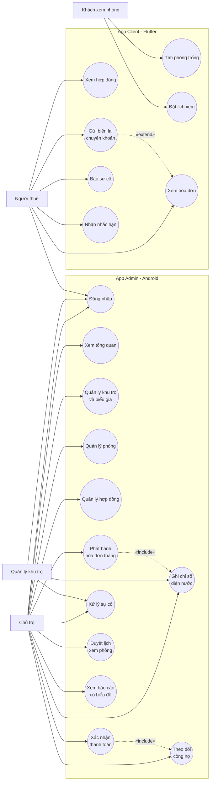

# Mục 2 – Phân tích yêu cầu

> Đề 12: *Hệ thống quản lý nhà trọ – phòng cho thuê*. Nhóm 555.
> Phạm vi tài liệu: phần phân tích dùng chung cho cả 3 thành phần (Backend, App Admin, App Client); các quyết định nghiệp vụ đều đặt ở backend.

## 2.1. Bối cảnh và vấn đề tồn tại

Phần lớn nhà trọ quy mô vừa (3–10 khu, 20–80 phòng) vẫn quản lý bằng sổ giấy và bảng tính:

| Hoạt động | Cách làm hiện tại | Vấn đề |
|---|---|---|
| Ghi chỉ số điện, nước | Ghi vào sổ, chụp ảnh đồng hồ rời rạc | Thất lạc số liệu, không đối chiếu được với tháng trước |
| Tính tiền hàng tháng | Bấm máy tính theo biểu giá từng khu | Sai số, mất thời gian khi phát hành cho 45 hợp đồng |
| Theo dõi công nợ | Ghi tay “đã đóng / chưa đóng” | Không biết phòng nào quá hạn 10 ngày, dễ bỏ sót |
| Hợp đồng | Bản giấy lưu trong tủ | Người thuê không có bản sao, khó kiểm tra ngày hết hạn |
| Sự cố | Gọi điện / nhắn tin | Không có trạng thái xử lý, dễ quên |
| Báo cáo | Tự cộng sổ cuối tháng | Không có số liệu theo thời gian thực |

Ba vấn đề nghiệp vụ cần giải quyết:

1. **Một nguồn dữ liệu duy nhất**: chủ trọ, quản lý và người thuê cùng nhìn một cơ sở dữ liệu, không phải đồng bộ tay.
2. **Tính tiền có kiểm soát**: tiền điện/nước tính từ chênh lệch chỉ số và biểu giá của khu; chặn chỉ số cuối nhỏ hơn chỉ số đầu; cảnh báo khi tiêu thụ tăng bất thường.
3. **Phát hành hóa đơn hàng loạt**: một lần gọi tạo hóa đơn cho toàn bộ hợp đồng đang hiệu lực của một khu, trong một transaction, bỏ qua phòng đã có hóa đơn và báo danh sách phòng thiếu chỉ số.

## 2.2. Phạm vi hệ thống

### Trong phạm vi

- Quản lý khu trọ, phòng, biểu giá điện/nước/phí rác/gửi xe theo từng khu.
- Quản lý hợp đồng thuê: tạo, gia hạn, kết thúc; cập nhật trạng thái phòng tương ứng.
- Ghi chỉ số điện nước theo tháng, chặn dữ liệu sai, cảnh báo tiêu thụ bất thường.
- Phát hành hóa đơn tháng cho cả khu; xem chi tiết từng khoản; theo dõi công nợ và lọc phòng nợ quá 10 ngày.
- Người thuê gửi xác nhận chuyển khoản kèm ảnh biên lai; chủ trọ xác nhận đã thu.
- Báo sự cố kèm ảnh; quản lý đổi trạng thái xử lý.
- Đặt lịch xem phòng; chủ trọ xác nhận hoặc từ chối.
- Báo cáo: doanh thu theo khu/tháng, tỷ lệ lấp đầy, công nợ, tiêu thụ bất thường, tổng quan.
- Phân quyền 2 vai trò quản trị: `CHU_TRO` và `QUAN_LY`.

### Ngoài phạm vi (không làm)

- Thanh toán trực tuyến qua cổng (VNPay, Momo). Hệ thống chỉ ghi nhận xác nhận chuyển khoản thủ công.
- Hóa đơn điện tử có mã số thuế, chữ ký số.
- Ứng dụng cho nhân viên bảo trì, chấm công, quản lý tài sản.
- Đồng bộ đa chi nhánh hoặc nhiều chủ trọ khác nhau trên cùng một tài khoản.
- Chat trực tiếp giữa người thuê và chủ trọ.

## 2.3. Tác nhân

| Tác nhân | Mô tả | Quyền chính |
|---|---|---|
| **Chủ trọ** (`CHU_TRO`) | Người sở hữu khu trọ, dùng App Admin | Toàn quyền: khu trọ, phòng, hợp đồng, biểu giá, chỉ số, hóa đơn, thanh toán, sự cố, lịch xem, báo cáo |
| **Quản lý khu trọ** (`QUAN_LY`) | Nhân viên vận hành được chủ trọ cấp tài khoản | Chỉ ghi chỉ số điện nước và xử lý sự cố; **không** xem doanh thu, **không** sửa biểu giá |
| **Người thuê** (`NGUOI_THUE`) | Người đang có hợp đồng, dùng App Client | Xem hợp đồng, hóa đơn, lịch sử thanh toán; gửi biên lai; báo sự cố; nhận nhắc hạn |
| **Khách xem phòng** | Người chưa có hợp đồng, dùng App Client | Tìm phòng trống, xem chi tiết, đặt lịch xem |

## 2.4. Danh sách use case

### App Admin (Android)

| Mã | Use case | Tác nhân | Màn hình |
|---|---|---|---|
| UC01 | Đăng nhập và lưu phiên | Chủ trọ, Quản lý | Đăng nhập |
| UC02 | Xem tổng quan hệ thống | Chủ trọ | Tổng quan |
| UC03 | Quản lý khu trọ và biểu giá | Chủ trọ | Khu trọ |
| UC04 | Quản lý phòng | Chủ trọ | Phòng |
| UC05 | Quản lý hợp đồng | Chủ trọ | Hợp đồng |
| UC06 | Ghi chỉ số điện nước | Chủ trọ, Quản lý | Ghi chỉ số |
| UC07 | Phát hành hóa đơn tháng | Chủ trọ | Hóa đơn |
| UC08 | Theo dõi hóa đơn, công nợ | Chủ trọ | Hóa đơn, Chi tiết hóa đơn |
| UC09 | Xác nhận thanh toán | Chủ trọ | Thanh toán |
| UC10 | Xử lý sự cố | Chủ trọ, Quản lý | Sự cố |
| UC11 | Duyệt lịch xem phòng | Chủ trọ | Lịch xem |
| UC12 | Xem báo cáo và biểu đồ | Chủ trọ | Báo cáo |

### App Client (Flutter)

| Mã | Use case | Tác nhân |
|---|---|---|
| UC13 | Tìm phòng trống theo bộ lọc | Khách xem phòng |
| UC14 | Đặt lịch xem phòng | Khách xem phòng |
| UC15 | Xem hợp đồng của tôi | Người thuê |
| UC16 | Xem hóa đơn và lịch sử thanh toán | Người thuê |
| UC17 | Gửi xác nhận chuyển khoản kèm biên lai | Người thuê |
| UC18 | Báo sự cố kèm ảnh | Người thuê |
| UC19 | Nhận nhắc hạn đóng tiền / hợp đồng sắp hết | Người thuê |

## 2.5. Sơ đồ use case tổng quát

> Ghi chú: `QUAN_LY` không có đường liên kết tới UC02–UC05, UC07–UC09, UC11, UC12. Việc ẩn menu chỉ là lớp giao diện; backend trả `403` nếu gọi trực tiếp các API doanh thu hoặc sửa biểu giá.

## 2.6. Mô tả chi tiết 6 use case trọng yếu

### UC06 – Ghi chỉ số điện nước

| Thành phần | Nội dung |
|---|---|
| **Tác nhân** | Chủ trọ, Quản lý khu trọ |
| **Tiền điều kiện** | Đã đăng nhập; phòng có hợp đồng đang hiệu lực; tháng chưa được ghi chỉ số |
| **Luồng chính** | 1. Người dùng chọn khu và tháng. 2. Hệ thống tải danh sách phòng kèm chỉ số đầu kỳ (lấy từ chỉ số cuối tháng trước). 3. Người dùng nhập chỉ số cuối cho từng phòng. 4. App hiển thị tiêu thụ dự kiến = cuối − đầu. 5. Người dùng bấm Lưu; app gửi `POST /chi-so-dien-nuoc`. 6. Backend kiểm tra, ghi nhận và trả kết quả; app hiển thị Snackbar thành công. |
| **Luồng thay thế** | 3a. Chỉ số cuối nhỏ hơn chỉ số đầu → backend trả `400` kèm `chi_tiet.truong`; app `setError` đúng ô nhập. 3b. Tháng đã có chỉ số → `409`; app báo “tháng này đã ghi chỉ số”. 3c. Tiêu thụ điện cao hơn 50% trung bình 3 tháng trước → backend trả `canh_bao`; app hiện cảnh báo vàng và yêu cầu xác nhận lại trước khi lưu. |
| **Hậu điều kiện** | Bản ghi `chi_so_dien_nuoc` được tạo; `ghi_boi` = id người gọi; dữ liệu sẵn sàng cho phát hành hóa đơn. |

### UC07 – Phát hành hóa đơn tháng cho cả khu

| Thành phần | Nội dung |
|---|---|
| **Tác nhân** | Chủ trọ |
| **Tiền điều kiện** | Đã đăng nhập vai trò `CHU_TRO`; khu có biểu giá; tháng có chỉ số của phần lớn phòng |
| **Luồng chính** | 1. Người dùng chọn khu và tháng. 2. Bấm “Phát hành hóa đơn”, app khóa nút để tránh bấm hai lần. 3. App gọi `POST /hoa-don/phat-hanh?thang=YYYY-MM&khuTro=ID`. 4. Backend mở transaction, lấy biểu giá khu, tính tiền phòng + điện + nước + rác + gửi xe cho từng hợp đồng đang hiệu lực. 5. Tạo `hoa_don` và `chi_tiet_hoa_don`; đặt hạn thanh toán. 6. Trả về số hóa đơn đã tạo, danh sách bỏ qua, phòng thiếu chỉ số, cảnh báo bất thường. 7. App hiển thị kết quả trong dialog. |
| **Luồng thay thế** | 4a. Phòng đã có hóa đơn tháng đó → bỏ qua, không lỗi. 4b. Phòng chưa có chỉ số → không tạo, đưa vào `thieu_chi_so`. 4c. Lỗi bất kỳ giữa chừng → `ROLLBACK` toàn bộ, trả `500`. |
| **Hậu điều kiện** | Hóa đơn và chi tiết được tạo nguyên tử (all-or-nothing); không có hóa đơn rác. |

### UC09 – Xác nhận thanh toán

| Thành phần | Nội dung |
|---|---|
| **Tác nhân** | Chủ trọ |
| **Tiền điều kiện** | Có giao dịch `thanh_toan` ở trạng thái chờ xác nhận (`xac_nhan_boi IS NULL`) |
| **Luồng chính** | 1. Chủ trọ mở màn Thanh toán, xem danh sách giao dịch chờ. 2. Bấm “Xem biên lai” để đối chiếu ảnh người thuê gửi. 3. Bấm “Xác nhận đã thu”, dialog xác nhận hiện ra. 4. App gọi `PATCH /thanh-toan/:id/xac-nhan`. 5. Backend dùng transaction cộng `da_thu`, cập nhật trạng thái hóa đơn (`MOT_PHAN` / `DA_THU`) và ghi người xác nhận. 6. App tải lại danh sách và hiển thị Snackbar. |
| **Luồng thay thế** | 3a. Người dùng hủy dialog → không gọi API. 4a. Giao dịch đã được xác nhận trước đó → `409`. 4b. Token hết hạn → `401`, app tự đăng xuất. |
| **Hậu điều kiện** | Hóa đơn phản ánh đúng số đã thu và còn nợ; lịch sử thanh toán có người xác nhận. |

### UC14 – Đặt lịch xem phòng

| Thành phần | Nội dung |
|---|---|
| **Tác nhân** | Khách xem phòng |
| **Tiền điều kiện** | Phòng đang `TRONG`; thời gian hẹn ở tương lai |
| **Luồng chính** | 1. Khách mở chi tiết phòng. 2. Chọn ngày, giờ bằng date/time picker. 3. Gửi `POST /lich-xem-phong`. 4. Backend kiểm tra phòng còn trống, thời gian hợp lệ, không trùng lịch cùng phòng. 5. Tạo lịch trạng thái `CHO_XAC_NHAN`; trả kết quả. 6. App quay về màn trước và hiện Snackbar. |
| **Luồng thay thế** | 2a. Chọn thời gian trong quá khứ → `400`. 4a. Phòng đã có người đặt cùng khung giờ → `409`. 4b. Phòng không còn trống → `400`. |
| **Hậu điều kiện** | Lịch xem xuất hiện trong App Admin để chủ trọ duyệt (UC11). |

### UC18 – Báo sự cố kèm ảnh

| Thành phần | Nội dung |
|---|---|
| **Tác nhân** | Người thuê |
| **Tiền điều kiện** | Đã đăng nhập; có hợp đồng đang hiệu lực |
| **Luồng chính** | 1. Người thuê chọn loại sự cố, nhập mô tả, chọn ảnh. 2. App gửi multipart `POST /bao-su-co`. 3. Backend lưu ảnh lên Supabase Storage (tối đa 5 MB), lưu URL vào `bao_su_co`. 4. Tạo bản ghi trạng thái `MOI`. 5. App hiển thị sự cố trong danh sách của tôi. |
| **Luồng thay thế** | 1a. Ảnh sai định dạng hoặc quá 5 MB → `400`. 2a. Mất mạng → app giữ form, hiện lỗi và cho thử lại. |
| **Hậu điều kiện** | Sự cố xuất hiện trong App Admin; quản lý có thể nhận xử lý (UC10). |

### UC12 – Xem báo cáo công nợ và biểu đồ

| Thành phần | Nội dung |
|---|---|
| **Tác nhân** | Chủ trọ |
| **Tiền điều kiện** | Đã đăng nhập vai trò `CHU_TRO` |
| **Luồng chính** | 1. Người dùng mở màn Báo cáo. 2. App gọi song song `GET /bao-cao/tong-quan`, `/bao-cao/cong-no`, `/bao-cao/lap-day`, `/bao-cao/doanh-thu`, `/bao-cao/tieu-thu-bat-thuong`. 3. Dữ liệu được vẽ: cột doanh thu theo khu, tròn tỷ lệ lấp đầy, bảng công nợ, danh sách tiêu thụ bất thường. 4. Người dùng đổi bộ lọc khu/tháng, app gọi lại. |
| **Luồng thay thế** | 2a. `QUAN_LY` gọi `/bao-cao/doanh-thu` → `403`. 2b. Mất mạng → hiện trạng thái lỗi kèm nút “Thử lại”, giữ dữ liệu cũ nếu đã có. |
| **Hậu điều kiện** | Không thay đổi dữ liệu; chỉ đọc. |

## 2.7. Yêu cầu phi chức năng

| Nhóm | Yêu cầu | Cách đáp ứng |
|---|---|---|
| Hiệu năng | Danh sách 60 phòng tải dưới 3 giây khi backend đã thức | Phân trang mặc định, `limit` hợp lý, RecyclerView tái sử dụng ViewHolder |
| Khả dụng | Render Free ngủ sau 15 phút | Timeout Retrofit 90 giây; thông báo “máy chủ đang khởi động” khi timeout |
| Bảo mật | Token JWT, không lưu mật khẩu | SharedPreferences chỉ lưu token + hồ sơ; mật khẩu gửi một lần qua HTTPS |
| Bảo mật | Phân quyền thật ở backend | Middleware `xacThuc` + `choPhep`; app chỉ ẩn menu |
| Toàn vẹn | Không tạo hóa đơn trùng | `UNIQUE(hop_dong_id, thang)` + kiểm tra trước khi insert |
| Toàn vẹn | Không nhận chỉ số vô lý | `CHECK(dien_cuoi >= dien_dau)`, `CHECK(nuoc_cuoi >= nuoc_dau)` |
| Trải nghiệm | Không mất dữ liệu khi xoay | `onSaveInstanceState`, ViewModel, hoặc tải lại theo id |
| Trải nghiệm | 3 trạng thái rõ ràng | `TrangThaiManHinh`: đang tải / xong / lỗi + rỗng |
| Tương thích | Máy Android 7.0 trở lên | `minSdk 24`, `targetSdk 37` |
| Ngôn ngữ | Toàn bộ giao diện tiếng Việt | `strings.xml` + định dạng `vi-VN` |

## 2.8. Ràng buộc nghiệp vụ quan trọng

1. **Tiền do backend tính**, app chỉ hiển thị. Công thức:
   `tong_tien = gia_thue + (dien_cuoi − dien_dau) × gia_dien + (nuoc_cuoi − nuoc_dau) × gia_nuoc + phi_rac + phi_gui_xe`.
2. **Chỉ số cuối không nhỏ hơn chỉ số đầu** — chặn ở cả CSDL (`CHECK`) và API (`400`).
3. **Cảnh báo tăng vọt**: tiêu thụ điện tháng này > 150% trung bình 3 tháng trước.
4. **Nợ quá 10 ngày**: `han_thanh_toan + 10 ngày < hôm nay` và hóa đơn chưa `DA_THU`.
5. **Một hóa đơn / hợp đồng / tháng** — ràng buộc `UNIQUE`.
6. **Không xóa phòng đang có hợp đồng** — backend trả `409`.
7. **`QUAN_LY` không được xem doanh thu, không sửa biểu giá** — backend trả `403`.

## 2.9. Chỗ cần chèn hình

- `[chèn ảnh: sơ đồ use case tổng quát – xuất từ Mermaid ở mục 2.5]`
- `[chèn ảnh: sơ đồ luồng nghiệp vụ phát hành hóa đơn – có thể vẽ lại theo UC07]`
- `[chèn ảnh: bảng phân quyền 2 vai trò trên App Admin]`
