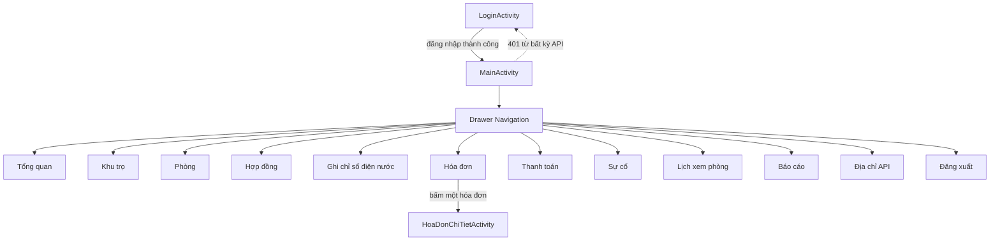

# Mục 5 – Thiết kế giao diện App Admin (Android)

> App: **555Rental Admin** – package `com.nhom555.rentaladmin` – Java + XML – `minSdk 24`, `targetSdk 37`.
> Toàn bộ giao diện tiếng Việt, dùng Material Components 1.12.0, một `MainActivity` chứa các `Fragment` và hai `Activity` riêng cho đăng nhập và chi tiết hóa đơn.

## 5.1. Kiến trúc tổng thể

```
com.nhom555.rentaladmin
├── data/                 # Tầng dữ liệu
│   ├── ApiClient.java    # Retrofit + OkHttp + interceptor token + timeout 90s
│   ├── ApiService.java   # Khai báo toàn bộ endpoint
│   ├── ApiCallback.java  # Callback dùng chung: 2xx / 401 / 4xx / mất mạng
│   ├── TokenStore.java   # SharedPreferences: token, vai trò, base URL
│   └── model/            # 43 lớp DTO ánh xạ snake_case của backend
├── ui/
│   ├── login/            # LoginActivity
│   ├── main/             # MainActivity + Drawer
│   ├── tongquan/         # Dashboard
│   ├── khutro/  phong/  hopdong/
│   ├── chiso/  hoadon/  thanhtoan/
│   ├── suco/  lichxem/  baocao/
│   └── common/           # PhienDangNhap, TrangThaiManHinh
└── util/                 # DinhDang, GiaoDien, TrangThai, Anh
```

**Luồng dữ liệu một chiều:**

`Fragment/Activity` → `ApiService` → `Retrofit/OkHttp` (gắn `Authorization: Bearer`) → Backend → `ApiCallback` → cập nhật View.

Không có ViewModel phức tạp; trạng thái màn hình được quản lý bằng `TrangThaiManHinh` (đang tải / xong / lỗi / rỗng) và `onSaveInstanceState` cho các trường lọc.

## 5.2. Sơ đồ điều hướng



- `QUAN_LY` chỉ thấy **Ghi chỉ số**, **Sự cố**, **Địa chỉ API**, **Đăng xuất**. Màn mặc định là Ghi chỉ số.
- `CHU_TRO` thấy đủ 10 mục nghiệp vụ.
- Nếu `QUAN_LY` cố mở màn bị chặn bằng mã (deep link / khôi phục trạng thái), `MainActivity` kiểm tra lại id mục và quay về màn mặc định.

## 5.3. Danh sách màn hình

| # | Màn hình | Loại | File chính | Chức năng |
|---|---|---|---|---|
| 1 | Đăng nhập | Activity | `LoginActivity` | Xác thực, lưu token, đổi địa chỉ API |
| 2 | Tổng quan | Fragment | `TongQuanFragment` | Thẻ số liệu, lối tắt nghiệp vụ |
| 3 | Khu trọ | Fragment + RecyclerView | `KhuTroFragment` | CRUD khu trọ, sửa biểu giá |
| 4 | Phòng | Fragment + RecyclerView | `PhongFragment` | CRUD phòng, lọc theo khu/trạng thái/tìm kiếm |
| 5 | Hợp đồng | Fragment + RecyclerView | `HopDongFragment` | Tạo, gia hạn, kết thúc hợp đồng |
| 6 | Ghi chỉ số | Fragment + RecyclerView | `ChiSoFragment` | Nhập chỉ số cuối, tính tiêu thụ, cảnh báo |
| 7 | Hóa đơn | Fragment + RecyclerView | `HoaDonFragment` | Lọc hóa đơn, phát hành tháng, lọc nợ > 10 ngày |
| 8 | Chi tiết hóa đơn | Activity | `HoaDonChiTietActivity` | Các khoản, chỉ số, lịch sử thanh toán, ảnh biên lai |
| 9 | Thanh toán | Fragment + RecyclerView | `ThanhToanFragment` | Duyệt giao dịch, xem biên lai, xác nhận đã thu |
| 10 | Sự cố | Fragment + RecyclerView | `SuCoFragment` | Xem chi tiết, đổi trạng thái xử lý |
| 11 | Lịch xem phòng | Fragment + RecyclerView | `LichXemFragment` | Xác nhận / từ chối lịch hẹn |
| 12 | Báo cáo | Fragment + MPAndroidChart | `BaoCaoFragment` | Biểu đồ cột, biểu đồ tròn, công nợ, bất thường |

Ngoài ra có 7 dialog: `dialog_khu_tro`, `dialog_phong`, `dialog_hop_dong`, `dialog_chi_so`, `dialog_phat_hanh`, `dialog_su_co`, và dialog đổi địa chỉ API.

## 5.4. Chi tiết từng màn hình

### 5.4.1. Đăng nhập – `activity_login.xml`

| Thành phần | Mô tả |
|---|---|
| Logo + tên app | “555Rental Admin”, phụ đề “Quản lý nhà trọ · Nhóm 555” |
| `TextInputLayout` email | Bàn phím email, `setError` khi sai định dạng |
| `TextInputLayout` mật khẩu | `inputType=textPassword`, nút hiện/ẩn mật khẩu |
| Nút Đăng nhập | Bị vô hiệu hóa + alpha 0.6 khi đang gọi API |
| `ProgressBar` | Hiện trong lúc chờ |
| `txt_loi` | Khung đỏ hiển thị lỗi 401 / 500 / mất mạng |
| Hai chip tài khoản demo | Điền nhanh `chutro@555rental.vn` hoặc `quanly@555rental.vn`, mật khẩu `123456` |
| Nút “Địa chỉ API” | Mở dialog sửa `BASE_URL`, lưu vào SharedPreferences, gọi `ApiClient.datLai()` |

**Kiểm tra hợp lệ:** email rỗng → “Vui lòng nhập email”; sai định dạng → “Email không đúng định dạng”; mật khẩu rỗng → “Vui lòng nhập mật khẩu”; dưới 6 ký tự → “Mật khẩu phải có ít nhất 6 ký tự”.

**Xử lý lỗi:** `401` → “Email hoặc mật khẩu không đúng.”; `SocketTimeoutException` → “Máy chủ đang khởi động (Render ngủ 15 phút)…”; `UnknownHostException` → “Không tìm thấy máy chủ…”.

**Lưu trạng thái:** email được lưu trong `onSaveInstanceState`, xoay màn hình không mất.

### 5.4.2. Tổng quan – `fragment_tong_quan.xml`

- Lời chào theo giờ + tên người dùng + mô tả vai trò.
- 6 thẻ số liệu: tổng phòng, đã thuê, trống, đang sửa, sự cố mới, đang xử lý.
- Thẻ tiền: phải thu, đã thu, còn nợ (chỉ `CHU_TRO`).
- 3 nút lối tắt: Ghi chỉ số, Hóa đơn, Sự cố (nút Hóa đơn bị ẩn với `QUAN_LY`).
- Dùng `SwipeRefreshLayout` để tải lại.

### 5.4.3. Khu trọ – `fragment_khu_tro.xml`

- `RecyclerView` thẻ khu trọ: tên, địa chỉ, phường/xã, tiện ích, biểu giá hiện tại, số phòng.
- Nút “Thêm khu trọ” ở góc dưới.
- Mỗi thẻ có menu: Sửa, Sửa biểu giá, Xóa.
- **Xóa** luôn qua `MaterialAlertDialogBuilder`: “Xóa khu trọ này? Các phòng bên trong có thể bị ảnh hưởng.” Nếu backend trả `409` (còn phòng/hợp đồng), hiển thị thông báo backend.
- **Form:** tên bắt buộc; địa chỉ bắt buộc; phường/xã bắt buộc; giá điện/nước/rác/gửi xe phải là số không âm. Lỗi hiển thị đúng `TextInputLayout`.

### 5.4.4. Phòng – `fragment_phong.xml`

- Bộ lọc: khu trọ, trạng thái (`Tất cả`, `Trống`, `Đã thuê`, `Đang sửa`), ô tìm theo số phòng.
- `RecyclerView` thẻ phòng: số phòng, khu, diện tích, giá thuê, sức chứa, badge trạng thái màu (xanh = trống, đỏ = đã thuê, vàng = đang sửa).
- Nút thêm/sửa/xóa; xóa có dialog xác nhận, backend chặn xóa phòng đang có hợp đồng (`409`).
- **Form:** số phòng bắt buộc; diện tích > 0; giá thuê > 0; sức chứa ≥ 1.
- Lưu ý kỹ thuật: khi chọn “Tất cả”, app gửi `trangThai=ALL` vì backend mặc định `TRONG` nếu thiếu tham số.

### 5.4.5. Hợp đồng – `fragment_hop_dong.xml`

- Lọc theo khu, trạng thái, tìm theo tên/số phòng.
- Thẻ hợp đồng: phòng, người thuê, ngày bắt đầu – kết thúc, tiền cọc, số người, badge trạng thái.
- Tạo hợp đồng: chọn phòng trống, chọn người thuê (`NGUOI_THUE`), chọn ngày, nhập kỳ hạn, tiền cọc, số người.
- **Kiểm tra:** ngày bắt đầu/kết thúc bắt buộc; kết thúc phải sau bắt đầu; tiền cọc ≥ 0; số người ≥ 1 và không vượt sức chứa (backend kiểm tra lần cuối).
- Gia hạn: nhập ngày kết thúc mới. Kết thúc: dialog xác nhận, backend đổi trạng thái phòng về `TRONG`.

### 5.4.6. Ghi chỉ số điện nước – `fragment_chi_so.xml`

Đây là màn hình nghiệp vụ chính của `QUAN_LY`.

- Chọn khu + tháng (mặc định tháng trước).
- `RecyclerView` mỗi dòng: số phòng, chỉ số đầu (điện/nước), ô nhập chỉ số cuối, tiêu thụ dự kiến cập nhật ngay khi gõ.
- Nút “Lưu chỉ số” trên từng dòng hoặc lưu hàng loạt theo thứ tự.
- **Dialog nhập:** hiển thị gợi ý “Chỉ số đầu tháng này: điện 1.637 – nước 174” lấy từ API `chi-so-dien-nuoc?phong=ID`.
- **Lỗi 400:** backend trả `chi_tiet.truong = dien_cuoi`, app gọi `setError("Chỉ số cuối không được nhỏ hơn chỉ số đầu")` đúng ô.
- **Cảnh báo tăng vọt:** nếu response có `canh_bao`, app hiện hộp thoại vàng “Tiêu thụ tăng X% so với trung bình 3 tháng” và yêu cầu xác nhận lại; người dùng có thể hủy để sửa.
- **409:** tháng đã ghi chỉ số → thông báo rõ, không ghi đè.

### 5.4.7. Hóa đơn – `fragment_hoa_don.xml`

- Bộ lọc: khu, tháng (`YYYY-MM`), trạng thái (`Tất cả`, `Chưa thu`, `Một phần`, `Đã thu`, `Quá hạn`).
- Chip “Nợ quá 10 ngày” gọi `GET /hoa-don?quaHan=10`.
- `RecyclerView` thẻ hóa đơn: phòng, khu, tháng, tổng tiền, đã thu, còn nợ, hạn, badge trạng thái.
- Nút “Phát hành hóa đơn tháng” mở `dialog_phat_hanh`: chọn khu + tháng, xác nhận.
- Khi phát hành: khóa nút, hiện ProgressBar; kết quả trong dialog gồm “Đã tạo N hóa đơn”, “Bỏ qua M”, “Thiếu chỉ số: phòng …”, “Cảnh báo bất thường”.
- Kiểm tra tháng bằng regex `^\d{4}-(0[1-9]|1[0-2])$`, báo lỗi ngay trên ô.
- Bấm một hóa đơn → `HoaDonChiTietActivity`.

### 5.4.8. Chi tiết hóa đơn – `activity_hoa_don_chi_tiet.xml`

- Thẻ thông tin: phòng, khu, tháng, người thuê + SĐT, hạn thanh toán, badge trạng thái.
- Thẻ tiền: tổng, đã thu, còn nợ (màu đỏ).
- Danh sách khoản: tên khoản, số lượng, thành tiền.
- Chỉ số điện/nước đầu → cuối và chênh lệch.
- Lịch sử thanh toán: thời điểm, số tiền, hình thức, trạng thái; nếu có `anh_bien_lai` hiện thumbnail 44dp, bấm vào mở dialog ảnh lớn (Glide).
- Trạng thái tải/lỗi dùng `TrangThaiManHinh`; lỗi có nút “Thử lại”.

### 5.4.9. Thanh toán – `fragment_thanh_toan.xml`

- Lọc theo khu và hóa đơn.
- Thẻ giao dịch: phòng, người thuê, số tiền, hình thức + thời điểm, thông tin hóa đơn, badge “Chờ xác nhận” / “Đã xác nhận”.
- Nút “Xem biên lai” (nếu có ảnh) mở dialog ảnh.
- Nút “Xác nhận đã thu” chỉ hiện với `CHU_TRO` và giao dịch chưa xác nhận; có dialog xác nhận trước khi gọi `PATCH /thanh-toan/:id/xac-nhan`.
- Sau khi xác nhận: Snackbar xanh + tải lại danh sách.

### 5.4.10. Sự cố – `fragment_su_co.xml`

- Lọc theo khu, trạng thái (`Mới`, `Đang xử lý`, `Đã xử lý`).
- Thẻ sự cố: loại, phòng + khu, mô tả rút gọn, người báo + SĐT, badge trạng thái, thời điểm xử lý.
- Bấm thẻ mở `dialog_su_co`: mô tả đầy đủ, người báo, trạng thái, ảnh đính kèm (bấm xem lớn).
- Nút hành động theo quy trình: `MỚI → ĐANG_XỬ_LY → DA_XU_LY`; mỗi bước có dialog xác nhận.
- `QUAN_LY` dùng được toàn bộ màn này.

### 5.4.11. Lịch xem phòng – `fragment_lich_xem.xml`

- Lọc theo khu, trạng thái.
- Thẻ lịch: phòng, khách, SĐT, thời gian hẹn, trạng thái.
- Nút “Xác nhận” / “Từ chối” gọi `PATCH /lich-xem-phong/:id`; từ chối bắt buộc xác nhận.

### 5.4.12. Báo cáo – `fragment_bao_cao.xml`

| Khối | Nội dung | Nguồn API |
|---|---|---|
| Doanh thu (chỉ `CHU_TRO`) | Thẻ tổng phải thu / đã thu / còn nợ / số hóa đơn + **biểu đồ cột nhóm** 6 tháng gần nhất | `GET /bao-cao/doanh-thu` |
| Lấp đầy | **Biểu đồ tròn** đã thuê / trống / đang sửa + thanh tiến trình từng khu | `GET /bao-cao/lap-day` |
| Công nợ | Tổng còn nợ, nợ quá 10 ngày, số hóa đơn nợ, top 5 hóa đơn quá hạn lâu nhất | `GET /bao-cao/cong-no` |
| Tiêu thụ bất thường | Danh sách phòng có mức tăng > 50%, chọn tháng | `GET /bao-cao/tieu-thu-bat-thuong` |

- Biểu đồ cột: 2 bộ dữ liệu “Phải thu” (xanh đậm) và “Đã thu” (xanh lá), trục tung định dạng “triệu đồng”.
- Biểu đồ tròn: lỗ giữa ghi “45/60 phòng đã thuê”; màu xanh lá = đã thuê, xanh dương = trống, vàng = đang sửa.
- `QUAN_LY` không thấy khối doanh thu; các khối còn lại vẫn xem được để phục vụ vận hành.
- Chọn tháng tiêu thụ bằng dialog 12 tháng gần nhất; tháng được lưu khi xoay màn hình.

## 5.5. Phân quyền giao diện

| Mục menu | `CHU_TRO` | `QUAN_LY` |
|---|---|---|
| Tổng quan | ✅ | ❌ |
| Khu trọ | ✅ | ❌ |
| Phòng | ✅ | ❌ |
| Hợp đồng | ✅ | ❌ |
| Ghi chỉ số điện nước | ✅ | ✅ (màn mặc định) |
| Hóa đơn | ✅ | ❌ |
| Thanh toán | ✅ | ❌ |
| Sự cố | ✅ | ✅ |
| Lịch xem phòng | ✅ | ❌ |
| Báo cáo | ✅ | ❌ (backend cũng chặn doanh thu) |

**Nguyên tắc:** ẩn menu chỉ là trải nghiệm. Quyền thật do backend kiểm tra bằng JWT + `choPhep('CHU_TRO')`. App hiển thị nguyên văn thông báo `403` của backend nếu vượt quyền.

## 5.6. Ngôn ngữ thiết kế

| Yếu tố | Quy định |
|---|---|
| Màu chính | `brand_700 #1B4A63`, `brand_500 #0E7490` |
| Màu trạng thái | Thành công `#15803D`, cảnh báo `#B45309`, nguy hiểm `#B91C1C` |
| Nền | `#F4F7F9`, thẻ trắng bo góc 16dp |
| Chữ | Tiêu đề 18–20sp đậm, nội dung 13–14sp, phụ 11–12sp |
| Khoảng cách | Bội số 4dp; padding thẻ 16dp; cách thẻ 12dp |
| Badge | Bo tròn hoàn toàn, nền nhạt + chữ đậm cùng hệ màu |
| Nút hành động | MaterialButton bo góc 12dp, chữ 12–14sp |
| Trạng thái rỗng | Icon + câu giải thích + nút “Thử lại” (nếu lỗi) |

## 5.7. Ba trạng thái màn hình

`TrangThaiManHinh` bọc một `FrameLayout` có 4 lớp:

1. **Đang tải:** `ProgressBar` + “Đang tải dữ liệu…”.
2. **Thành công:** ẩn lớp trạng thái, hiện nội dung.
3. **Rỗng:** icon + thông điệp theo màn hình (ví dụ “Không có sự cố phù hợp bộ lọc.”).
4. **Lỗi mạng / lỗi API:** icon cảnh báo + thông điệp thân thiện + nút “Thử lại” gọi lại đúng hàm tải.

Danh sách còn có `SwipeRefreshLayout` để kéo xuống tải lại mà không cần rời màn hình.

## 5.8. Không mất dữ liệu khi xoay màn hình

| Màn hình | Cơ chế |
|---|---|
| Đăng nhập | `onSaveInstanceState` lưu email |
| MainActivity | Lưu `dang_chon` (mục menu đang chọn), khôi phục Fragment sau xoay |
| Báo cáo | Lưu `thang_bat_thuong` |
| Hóa đơn | Lưu bộ lọc khu/tháng/trạng thái trong `onSaveInstanceState` |
| Ghi chỉ số | Lưu khu/tháng đang chọn; dialog nhập dở được đóng an toàn, dữ liệu đã lưu trước đó không mất |
| Các form thêm/sửa | Dialog được tạo lại từ dữ liệu bản ghi, không giữ con trỏ View cũ |
| Toàn app | `ApiCallback.conSong()` chặn cập nhật View sau khi Fragment/Activity đã hủy |

## 5.9. Ánh xạ màn hình → API

| Màn hình | Endpoint chính |
|---|---|
| Đăng nhập | `POST /auth/dang-nhap`, `GET /auth/toi` |
| Tổng quan | `GET /bao-cao/tong-quan` |
| Khu trọ | `GET/POST/PATCH/DELETE /khu-tro`, `GET/PATCH /bieu-gia/{id}` |
| Phòng | `GET/POST/PATCH/DELETE /phong` |
| Hợp đồng | `GET/POST/PATCH /hop-dong`, `GET /phong?trangThai=TRONG`, `GET /nguoi-dung?vaiTro=NGUOI_THUE` |
| Ghi chỉ số | `GET /chi-so-dien-nuoc`, `GET /chi-so-dien-nuoc?phong=`, `POST /chi-so-dien-nuoc` |
| Hóa đơn | `GET /hoa-don`, `POST /hoa-don/phat-hanh` |
| Chi tiết hóa đơn | `GET /hoa-don/{id}` |
| Thanh toán | `GET /thanh-toan`, `PATCH /thanh-toan/{id}/xac-nhan` |
| Sự cố | `GET /bao-su-co`, `PATCH /bao-su-co/{id}` |
| Lịch xem | `GET /lich-xem-phong`, `PATCH /lich-xem-phong/{id}` |
| Báo cáo | `GET /bao-cao/doanh-thu`, `/cong-no`, `/lap-day`, `/tieu-thu-bat-thuong` |

## 5.10. Chỗ cần chèn hình

- `[chèn ảnh: màn hình đăng nhập]`
- `[chèn ảnh: drawer + tổng quan]`
- `[chèn ảnh: danh sách khu trọ]`
- `[chèn ảnh: danh sách phòng với bộ lọc trạng thái]`
- `[chèn ảnh: form tạo hợp đồng]`
- `[chèn ảnh: ghi chỉ số + cảnh báo tăng vọt]`
- `[chèn ảnh: dialog phát hành hóa đơn với kết quả]`
- `[chèn ảnh: chi tiết hóa đơn + ảnh biên lai]`
- `[chèn ảnh: xác nhận thanh toán]`
- `[chèn ảnh: chi tiết sự cố + đổi trạng thái]`
- `[chèn ảnh: báo cáo có biểu đồ cột và biểu đồ tròn]`
- `[chèn ảnh: màn hình QUAN_LY bị ẩn menu]`
